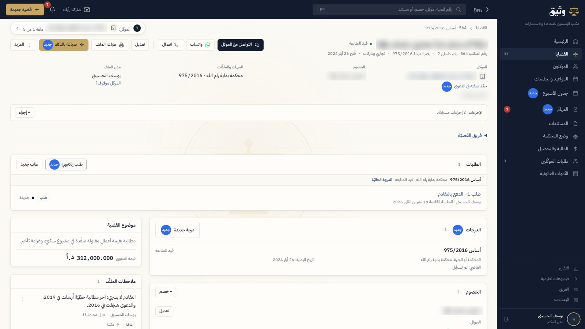
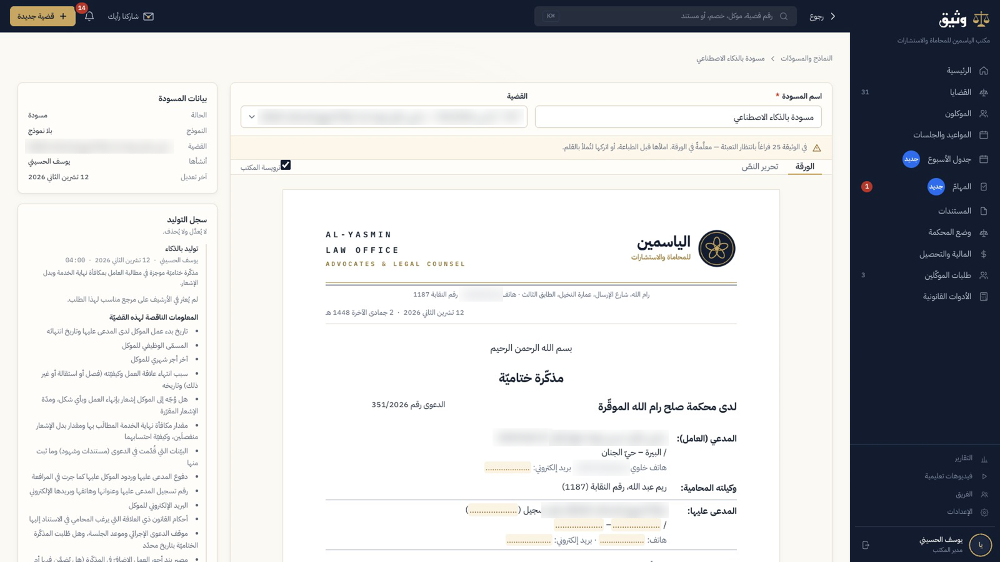
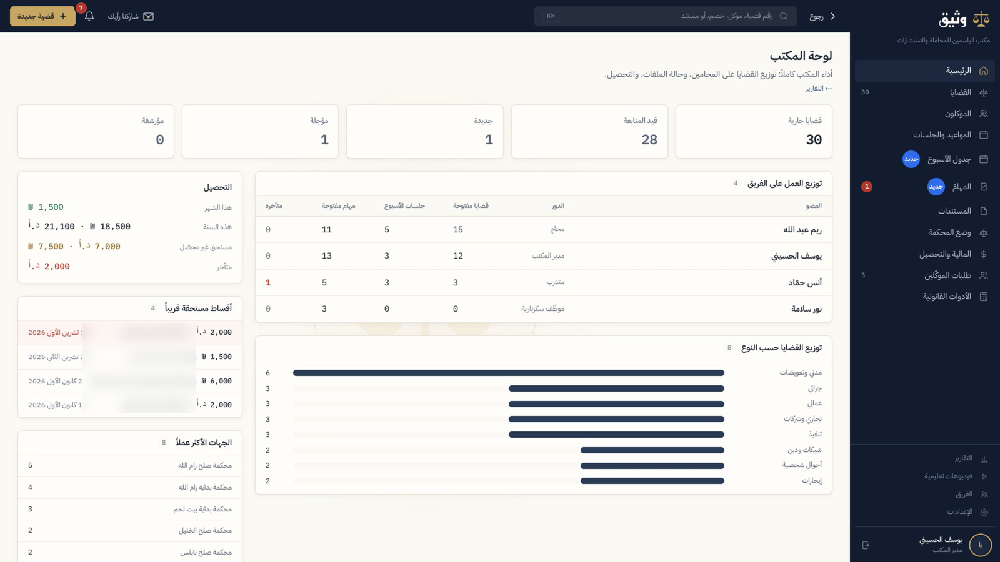
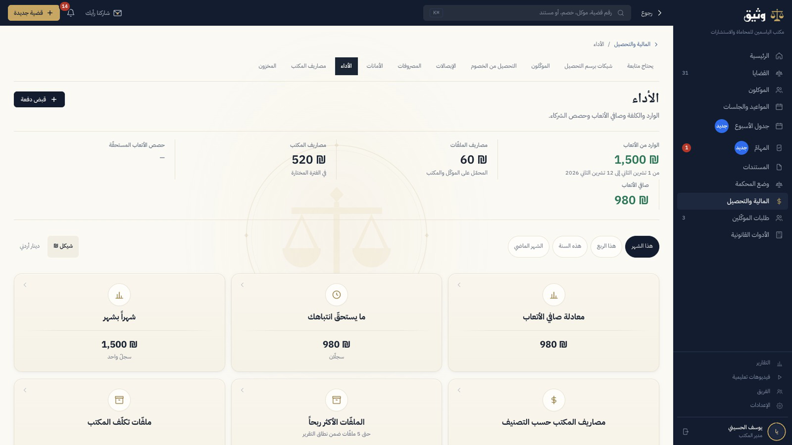
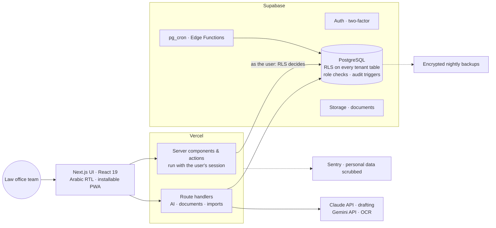

# Watheeq · وثيق — case study

**Arabic-first practice management for law offices: cases, court dates, clients, documents and money in
one multi-tenant SaaS. Designed, built and operated by one developer.**

`Next.js 15` · `React 19` · `TypeScript` · `PostgreSQL / Supabase` · `Row-Level Security` · `Vercel` · `Claude & Gemini APIs` · `Vitest` · `Playwright`

> The product code is proprietary and private. This repository explains the problem, the architecture
> and the engineering decisions, with small snippets written fresh for illustration.

<b>Kurzfassung auf Deutsch</b>

Watheeq ist eine arabischsprachige (RTL) SaaS-Plattform für Anwaltskanzleien: Akten, Gerichtstermine und
Fristen, Mandanten, Dokumente und Kanzleibuchhaltung. Ich habe sie allein konzipiert, entwickelt und
betreibe sie; sie ist in der Testphase mit rund 30 registrierten Kanzleien. Die Mandantentrennung liegt
in PostgreSQL selbst (Row-Level Security) und wird automatisch geprüft: 107 Tabellen, mehrere Rollen,
0 Lecks. Ein unveränderliches Audit-Log entsteht per Datenbank-Trigger. Rund 8.600 automatisierte Tests
sichern Änderungen ab. Eine Performance-Analyse am 24.11.2026 senkte die Datenbankzeit pro Seite von
etwa 1,6 s auf 0,25 s (Faktor 6,6), bei nachweislich identischen Ergebnissen für jede Testkanzlei und Rolle.

## At a glance

| | |
|---|---|
| **What** | Practice management for law offices in Palestine: case files, court sessions and deadlines, clients, documents with the office letterhead, and office finance in three currencies. |
| **Status** | Test phase, about **30 registered law offices** (November 2026). |
| **My role** | Everything: product, data model, backend, frontend, AI features, deployments, monitoring, support. |
| **Since** | May 2026 |
| **Codebase** | ~**8,600** automated tests · 350+ SQL migrations · 10 Edge Functions |
| **Isolation check** | Automated cross-tenant test over **107 tables**, several roles: **0 leaks** |
| **Performance** | Database time per page **1.6 s → 0.25 s** (6.6×) after a measured investigation |

## Screenshots

*A fictional demo office on the test environment. Party names, phone and ID numbers are blurred anyway.*

| | |
|---|---|
|  |  |
| **Case file:** parties, court levels, requests and the team in one place. | **AI draft** from the office's own templates, on its letterhead. Missing facts stay as visible blanks and are listed on the left instead of being invented. |
|  |  |
| **Office dashboard:** workload per team member, collections in ₪ / JD / $, upcoming instalments. | **Finance:** fees, case expenses and office expenses per period and currency. |

## The problem

A small law office juggles dozens of open cases, each with court sessions, deadlines, opposing parties,
documents and money: fees, instalments, court costs and client money held in trust. In many offices this
lives in paper folders, spreadsheets and chat threads. A missed court date or a wrong balance has real
consequences, and the data is among the most confidential an office holds.

Watheeq brings it into one place, in Arabic, right-to-left, with Latin digits as offices write them in
documents, and with Gregorian and Hijri dates where legal paperwork needs both.

**Users:** the office owner, lawyers, trainees, office staff and accountants, each with their own permissions.

## Architecture

The rule of the design: **the database decides who sees what.** Application code runs queries with the
signed-in user's session, so a forgotten tenant filter in a page cannot leak another office's data.
Row-level security does the filtering, and the same policies check the user's role.

## Engineering decisions

### 1. Tenant isolation lives in PostgreSQL, and it is tested like a feature

Every tenant-owned table carries the office key. Policies compare it with the offices the signed-in user
belongs to, through small helper functions. Where it matters, indexes lead with the office key, so a query
stays inside one office's slice of the data.

A policy that is missing on one table out of a hundred is easy to miss in review. So isolation has its
own automated test: it signs in as users of different offices and roles and checks **107 tables** for rows of
another office. Current result: **0 leaks**. The open-source tool
[**pg-tenant-probe**](https://github.com/mazendrop/pg-tenant-probe) is a generic version of this idea, written from scratch.

→ [`snippets/01-tenant-isolation.sql`](snippets/01-tenant-isolation.sql),
[`snippets/03-isolation-test.ts`](snippets/03-isolation-test.ts)

### 2. Roles are enforced by the database too

Owner, lawyer, trainee, office staff and accountant see different things. The interface hides what a role
cannot do, but the same rules sit in the policies, so a hidden button is never the only protection.

### 3. An audit log nobody can edit

Changes to important records are written to an audit log **by database triggers**, so no code path can
forget to log. The log itself rejects `UPDATE` and `DELETE`.

→ [`snippets/02-append-only-audit-log.sql`](snippets/02-append-only-audit-log.sql)

### 4. Money in three currencies, never mixed

Offices bill in shekels, Jordanian dinars and US dollars. Every amount carries its currency, and totals
are computed per currency rather than silently converted. Client money held in trust has its own ledger,
apart from the office's fees. Receipts and statements are produced as PDF and Word.

### 5. Documents that look like the office's own

Drafts, receipts and reports print on the office's letterhead, as PDF and as Word, with right-to-left
Arabic typesetting. The same document has to come out the same in every output path, and tests check that.

### 6. AI that assists and does not make things up

- **Drafting (Claude API):** drafts start from the office's own templates and similar documents in its
  archive (semantic search inside the office's own data only). Facts the case file does not contain stay as
  visible blanks and are listed for the lawyer (see the screenshot) instead of being guessed.
- **OCR (Gemini API):** reads ID cards and court papers into structured fields.
- **Points-based usage:** each AI action costs points, so usage and cost per office stay predictable.
- When an AI call fails, the user gets the actual reason in Arabic, not a generic "something went wrong".

### 7. Operations for a one-person team

- A separate test environment with fictional offices. Releases go out from Git through gates (type check,
  tests, dependency audit), then a staged deployment is promoted, with one-step rollback.
- Two-factor authentication, encrypted nightly backups, Sentry with personal data scrubbed before events
  leave the app.

## Performance investigation (24 November 2026)

**Symptom.** Pages were getting slower as test offices filled with data.

**Method.** Measure first, guess later. For each of the nine main pages: reset Postgres' statement statistics
(`pg_stat_statements`), load the page several times as one signed-in user, then add up the number of
queries and the database time that page caused.
→ [`snippets/04-measure-queries-per-page.sql`](snippets/04-measure-queries-per-page.sql)

**What it showed.** No single slow query, rather a pattern:

- the same data was read several times in one request;
- data was fetched for parts of the page that were not on screen;
- helper functions used inside row-level security policies were planned again on every query;
- independent reads waited for each other instead of running in parallel;
- a notification counter recounted everything every minute.

**What changed.** Related reads in one round trip (with an automatic fallback), read only what is shown,
policy helpers that Postgres can plan once, parallel independent reads, and a bounded notification query.

**How it was proven.** Before and after, every page was loaded for **every test office and every role**,
and the results had to be identical. The isolation test ran again as well.

| Measured on the test environment | Before | After | |
|---|---:|---:|---|
| Database time per page (mean of 9 pages) | 1,631 ms | **248 ms** | **6.6× less** |
| Queries per page (mean) | 73.6 | **52.1** | −29 % |
| Page response, median (mean of 9 pages) | 784 ms | **462 ms** | −41 % |
| 10 simultaneous users, median / p95 | 2.2 s / 9.0 s | **0.64 s / 1.8 s** | |

## Lessons

1. **Put a rule where it cannot be skipped.** Isolation and roles belong in the database. The UI is for convenience.
2. **A test that cannot fail proves nothing.** An isolation test is only meaningful if the test user can see
   its *own* rows and other tenants actually have rows to leak. Both are checked.
3. **Measure before optimising.** Counting queries per page found problems that no single slow-query log showed.
4. **Prove a refactor with identical output.** "Faster" only counts if every office and role still sees exactly the same data.
5. **Arabic-first is more than `dir="rtl"`:** bidirectional text with numbers and Latin names, Hijri and
   Gregorian dates, and digits that match how documents are written.

## Snippets

Small, generic examples written for this case study. They are not taken from the product code.

| File | Shows |
|---|---|
| [`01-tenant-isolation.sql`](snippets/01-tenant-isolation.sql) | Membership helper, policies with `WITH CHECK`, index led by the tenant key |
| [`02-append-only-audit-log.sql`](snippets/02-append-only-audit-log.sql) | Trigger-written audit log that rejects edits |
| [`03-isolation-test.ts`](snippets/03-isolation-test.ts) | A cross-tenant test in a normal test suite, using pg-tenant-probe |
| [`04-measure-queries-per-page.sql`](snippets/04-measure-queries-per-page.sql) | Counting queries and DB time per page with `pg_stat_statements` |

---

Mazen Abdallah · Wirtschaftsinformatik (B.Sc.) student at HTW Berlin ·
[LinkedIn](https://www.linkedin.com/in/mazen8abdallah) · [GitHub](https://github.com/mazendrop)
